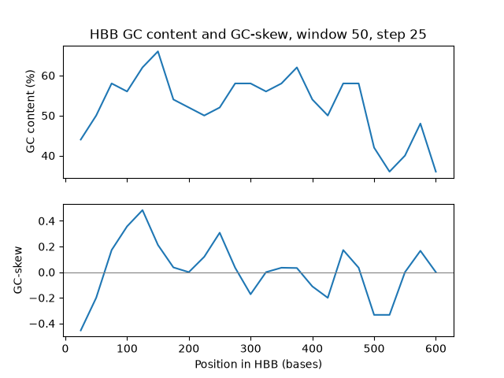

# Bioinformatics Foundations: Algorithmic Sequence Analysis in Python

A repository of foundational computational biology pipelines, sequence manipulation algorithms, and bio-data processing scripts. The core sequence logic is implemented in standard Python without external biocomputing dependencies (no Biopython). The vectorised and tabular modules use NumPy, pandas, and matplotlib.

Designed as an algorithmic foundation for genomic data analysis, high-throughput sequence parsing, and computational biology research.

---

## Repository Structure & Core Modules

The repository tracks progressive development from raw nucleotide manipulation, through an object-oriented sequence analysis pipeline, to vectorised and tabular analysis of real gene data:

| Module / Script | Focus Area | Description |
| :--- | :--- | :--- |
| `dna_sequence.py` (Phase 3) | **OOP Architecture** | Stateful `DNASequence` class encapsulating validation, transformations, and algorithmic scanning. Built to handle real NCBI genomic data (e.g., human HBB gene). |
| `phase1_capstone.py` | **End-to-End Pipeline** | Procedural integrated workflow for FASTA parsing, GC content calculations, motif search, and transcription. |
| `sample.fasta` | **Benchmark Dataset** | Standardized FASTA format input file used for testing validation and parsing modules. |
| `phase1_day1.py` – `phase1_day3.py` | **Sequence Fundamentals** | Nucleotide validation, purine/pyrimidine ratio calculations, and string transformation routines. |
| `phase1_day4.py` – `phase1_day6.py` | **Genomic Metrics** | GC-content profiling, local window scanning, and open reading frame (ORF) boundaries. |
| `phase01_day07.py` – `phase1_day9.py` | **Bio-Parsing & Motifs** | Custom flat-file FASTA ingestion, dictionary mapping of codons, and pattern-matching logic. |
| `phase1_summary.py` / `phase1_practice.py` | **Review & Drills** | Modular unit exercises testing edge cases in biological string operations. |
| `day5.py` – `day10.py` series | **Algorithmic Drills** | Iterative algorithm implementations covering nested iterations, coordinate mappings, and error-handling. |
| `mutation_finder.py` | **Variant Detection** | Point-mutation detection between sequences. |
| `numpy_day11.py` – `numpy_day15_16.py` (+ `numpy_11a.py`, `numpy_11b.py`) | **Vectorised Analysis** | NumPy boolean masks, GC counting, sliding-window GC% and GC-skew across the HBB gene, with matplotlib plots. |
| `panda_day17.py`, `panda_day17.1.py` | **Tabular Results** | Sliding-window GC output loaded into a pandas DataFrame (`head()`, `shape`). |
| `hbb_gc.png`, `hbb_gc_skew.png` | **Generated Plots** | GC content and GC-skew plots of the human HBB gene (window 50, step 25). |

---

## Key Capabilities Implemented

* **Stateful OOP Architecture:** Encapsulates sequence validation, state management, and biological transformations within a native `DNASequence` Python class, validated against real NCBI data (e.g., human HBB gene).
* **Strict Sequence Validation:** Accepts only the four standard DNA bases (A, T, C, G) and rejects empty or non-standard input, using $O(N)$ set-based validation.
* **Compositional Metrics:** Computes overall GC percentage and local composition variations, outputting structured data dictionaries for downstream processing.
* **Central Dogma Logic:** Implements DNA-to-RNA transcription and reverse complement generation using directional base pairing ($5' \rightarrow 3'$).
* **Flat-File Parsing & Sanitization:** Implements native line-by-line streaming and string sanitization of multiline FASTA records to prevent high-memory overhead on large sequence entries.
* **Algorithmic Motif Scanning:** Identifies point mutations and utilizes a sliding-window search algorithm returning standard 1-based biological sequence coordinates.
* **Vectorised Sliding-Window Analysis (NumPy):** Computes GC content and GC-skew per window using boolean masks, returning window midpoints and values for plotting.
* **Tabular Output (pandas):** Loads window results into a DataFrame for inspection and filtering.

---

## Example Output

GC content and GC-skew of the human HBB gene (628 bases, window 50, step 25):



---

## Getting Started

### Prerequisites
* Linux / WSL environment
* Python [ * Python 3.14 (developed on 3.14.4) ]
* NumPy, pandas, matplotlib (for the NumPy and pandas modules only)

### Setup

```bash
python3 -m venv .venv
source .venv/bin/activate
pip install -r requirements.txt
```

### Using the Object-Oriented Architecture (Phase 3)
Import and utilize the core `DNASequence` class within your own processing scripts:

```python
from dna_sequence import DNASequence

# Initialize sequence state and run foundational biocomputing methods
gene = DNASequence("ATGCGTACGTAGCTA")
print(f"GC Content: {gene.gc_content()}%")
print(f"RNA Transcript: {gene.transcribe()}")
```

### Running the Procedural Capstone Pipeline (Phase 1)
Execute the primary integrated pipeline against the test dataset:

```bash
python3 phase1_capstone.py
```

### Running the Sliding-Window Analysis (NumPy / pandas)
Generate the GC and GC-skew plot for the HBB gene:

```bash
python3 numpy_day15_16.py
```

---

## Author
**Mayank Somvanshi**  
Undergraduate Student in Bioinformatics  
GitHub: [@Mayank-Somvanshi](https://github.com/Mayank-Somvanshi)